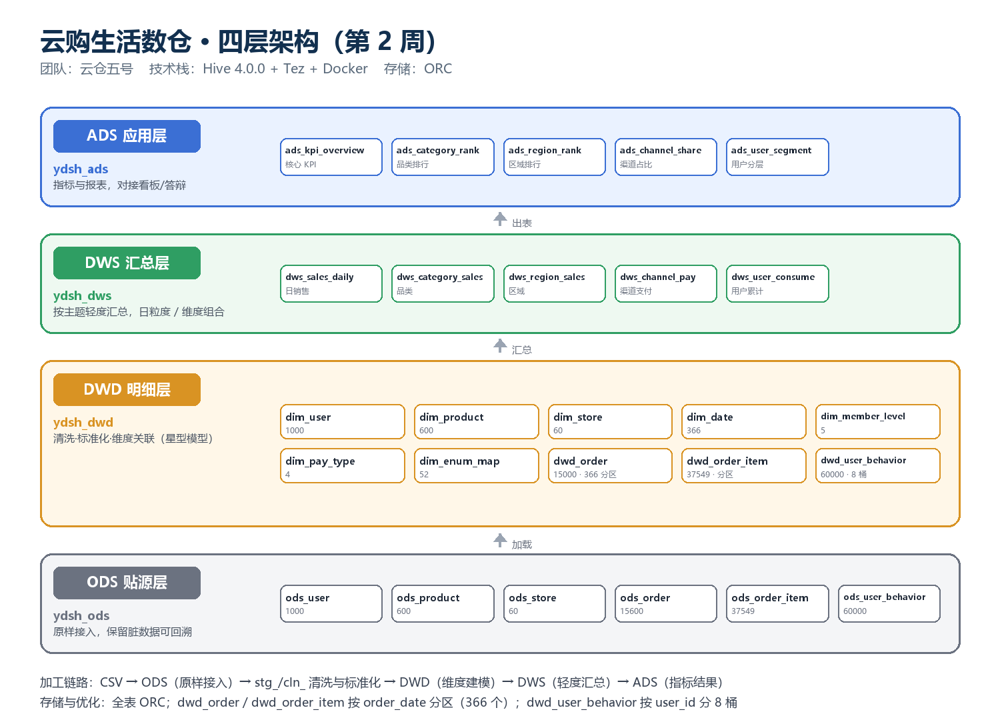

# 云购生活新零售 —— 企业级数据仓库

> 课程：企业项目实战实训
> 当前阶段：第 2 周 · 数据清洗进阶 · Hive 四层数仓建模 · 探索性分析

## 一、团队信息

| 项目 | 内容 |
|---|---|
| 团队名称 | 云仓五号 |
| 团队口号 | 把脏数据洗成决策 |
| 项目目标 | 完成 6 张业务表的采集导入、质量治理与分层建模，产出可运行的 Hive 四层数据仓库 |

### 成员与分工

| 姓名 | 角色 | 主要职责 |
|---|---|---|
| 刘祎炫 | 项目经理 | 进度把控、任务拆分、文档汇总、答辩组织、Git 仓库维护 |
| 张业彬 | 数据工程师 A（环境） | Docker / Hive / MySQL 环境搭建、容器排障、一键恢复脚本 |
| 闫洪伟 | 数据工程师 B（数据） | ODS 层 6 张表建表、数据导入、行数校验、DWD 建表与加载 |
| 柴传兴 | 数据分析师 | 数据质量五维度评估、枚举与异常值治理、指标口径、质量报告 |
| 邓克超 | 可视化工程师 | 数据探索、图表设计、看板与可视化（第 3～4 周开展） |

## 二、阶段计划

| 周次 | 内容 | 状态 |
|---|---|---|
| 第 1 周 | 环境搭建、ODS 导入、质量预评估、缺失值与重复值清洗 | ✅ 已完成 |
| 第 2 周 | 枚举/异常/格式清洗、数据质量对比报告、四层数仓建模、DWD 加载、探索性分析 | ✅ 已完成 |
| 第 3 周起 | DWS/ADS 指标扩展、可视化看板、指标口径治理 | 待开展 |

## 三、技术栈与环境

| 组件 | 版本 | 用途 |
|---|---|---|
| Docker Desktop | 4.96.3（Docker Engine 29.9.2） | 容器运行环境（WSL2 后端） |
| Docker Compose | v5.6.1 | 多容器编排 |
| Apache Hive | 4.0.0（Tez 0.10.3 执行引擎） | 数据仓库，包含 Metastore 与 HiveServer2 |
| MySQL | 8.0.46 | Hive 元数据库 |
| Git | 2.56.0 | 版本控制 |

服务端口（宿主机）：`10000`（HiveServer2）、`9083`（Metastore）、`3307`（MySQL）。

## 四、目录结构

```
.
├── docker-compose.yml                 # 三个服务的编排文件
├── 一键运行.bat                        # 第 1 周：启动 + 首轮清洗 + 展示
├── 一键运行_第2周.bat                   # 第 2 周：启动 + 四层加工 + 展示
├── lib/
│   └── mysql-connector-j-8.4.0.jar    # Hive 镜像缺失的 MySQL 驱动
├── sql/
│   ├── ods/
│   │   ├── create_ods.sql             # ODS 建库建表（6 张表）
│   │   └── load_ods.sql               # 数据导入与行数校验
│   ├── clean/                         # 清洗脚本（第 1 周 + 第 2 周）
│   │   ├── 00_quality_scan.sql        # 五维度扫描（只读）
│   │   ├── 01~05_dwd_*.sql            # 第 1 周：缺失值 / 日期 / 去重 / 异常标记
│   │   ├── 10_enum_standardize.sql    # 枚举字段标准化 + 映射表
│   │   ├── 11_anomaly_format.sql      # 异常值与格式标准化
│   │   ├── 12_split_merge.sql         # 字段拆分合并 + 订单去重
│   │   └── 13_quality_compare.sql     # 清洗前后质量对比（qc_metric）
│   ├── dwd/
│   │   ├── 00_ddl.sql                 # DWD/ADS 建库建表（7 维度 + 3 事实）
│   │   ├── 01_load_dim.sql            # 维度表加载
│   │   └── 02_load_fact.sql           # 事实表加载（分区 / 分桶）
│   ├── dws/20_dws.sql                 # DWS 汇总层（5 张）
│   ├── ads/30_ads.sql                 # ADS 应用层（5 张）
│   └── analysis/40_eda.sql            # 探索性分析
├── reports/
│   ├── 数据质量预评估表.xlsx            # 第 1 周五维度扫描
│   ├── 质量预评估表.md
│   ├── 第2周_数据质量对比报告.md        # 第 2 周：五类脏数据修复率
│   └── 第2周_探索性分析简报.md          # 第 2 周：分析结论
├── docs/
│   ├── 环境搭建笔记.md                 # 9 个环境问题的现象、排查与解决
│   ├── 云仓五号_第1周_AI协同日志.md
│   ├── 云仓五号_第2周_AI协同日志.md
│   ├── 第2周_数仓架构设计.md           # 四层架构、命名规范、建模决策
│   ├── 第2周_答辩手册.md               # 汇报提纲与问答准备
│   ├── 答辩手册.md                     # 第 1 周答辩材料
│   └── screenshots/                   # 环境截图 + 架构图 + 分析图表
└── 模拟数据/                           # 6 个 CSV（已 .gitignore 忽略，需自行放入）
```

## 五、分层架构



| 分层 | 库 | 内容 | 表数 |
|---|---|---|---|
| ODS 贴源层 | `ydsh_ods` | 6 张原始表，114,809 行，保留脏值可回溯 | 6（+第 1 周 6 张清洗表） |
| DWD 明细层 | `ydsh_dwd` | 7 维度 + 3 事实，ORC，订单按日分区、行为按用户分桶 | 10 |
| DWS 汇总层 | `ydsh_dws` | 日 / 品类 / 区域 / 渠道支付 / 用户累计 | 5 |
| ADS 应用层 | `ydsh_ads` | KPI、品类排行、区域排行、渠道占比、用户分层 | 5 |

## 六、快速开始

```powershell
# 第 1 周流程（环境 + 首轮清洗）
docker compose up -d
.\scripts\run-all.ps1

# 第 2 周流程（四层加工，10 个脚本按依赖顺序执行）
.\scripts\run-week2.ps1
```

或直接双击 `一键运行.bat`（第 1 周）/ `一键运行_第2周.bat`（第 2 周）。

### 桌面一键运行（推荐）

桌面上已放好两个快捷方式，双击即可：

| 桌面快捷方式 | 作用 |
|---|---|
| **第2周 一键运行** | 启 Docker → 等 Hive → 跑完 10 个脚本 → 自动打开结果看板 |
| **第2周 查看结果** | 不重跑，直接打开已生成的看板（秒开） |

> 快捷方式指向 `scripts/run-week2.ps1`；若项目目录移动，重新运行一次
> `scripts/create-desktop-shortcut.ps1` 即可重建。
> 脚本参数：`-SkipRun` 只看结果、`-NoPause` 结束不等待回车。

跑完想看结果：

| 方式 | 打开 |
|---|---|
| 可视化看板（推荐，浏览器） | [reports/第2周_运行看板.html](reports/第2周_运行看板.html) |
| 终端运行记录（真实输出） | [reports/第2周_运行记录.md](reports/第2周_运行记录.md) |
| 看板截图 | [docs/screenshots/第2周_运行看板.png](docs/screenshots/第2周_运行看板.png) |

> `模拟数据/` 需要自行放入 6 个 CSV（`ods_user.csv` 等），容器内通过 `/data` 挂载读取；数据文件按任务书要求不入版本库。

## 七、成果汇总

### 7.1 数据规模

| 层次 | 表 | 行数 |
|---|---|---:|
| ODS | 6 张原始表 | 114,809 |
| DWD | dim_user / dim_product / dim_store / dim_date | 1,000 / 600 / 60 / 366 |
| DWD | dwd_order / dwd_order_item / dwd_user_behavior | 15,000 / 37,549 / 60,000 |
| DWS | 5 张主题汇总 | 366 / 8 / 63 / 16 / 1,000 |
| ADS | 5 张指标表 | 7 / 8 / 15 / 4 / 4 |

### 7.2 数据质量（第 2 周）

| 脏数据类型 | 问题数 | 已修复 | 修复率 |
|---|---:|---:|---:|
| 缺失值 | 380 | 187 | 49.2% |
| 重复值 | 600 | 600 | 100% |
| 异常值 | 1,718 | 1,718 | 100% |
| 枚举不规范 | 5,132 | 5,132 | 100% |
| 格式不一致 | 8,150 | 8,150 | 100% |
| **合计** | **15,980** | **15,787** | **98.8%** |

未修复的 193 条为邮箱缺失（无法推断，保留 + 标记）。

### 7.3 核心指标

| 指标 | 数值 |
|---|---:|
| 有效订单量 | 14,696 单 |
| GMV | 3,702.79 万元 |
| 客单价 AOV | 2,519.59 元 |
| 品类第一 | 运动户外（14.88%） |
| 渠道结构 | APP 25.47% / 门店 25.00% / PC官网 24.92% / 小程序 24.62% |

详细数据见 [reports/第2周_数据质量对比报告.md](reports/第2周_数据质量对比报告.md)、[reports/第2周_探索性分析简报.md](reports/第2周_探索性分析简报.md)。

## 八、说明

- **ODS 层保留原始数据**：原始表不做任何修改，便于回溯与对比。
- **清洗采用 CTAS**：Hive 非事务表不支持 UPDATE，清洗通过重建表实现，脚本可重复执行。
- **能推断的修正、不能推断的置空、全部打标**：异常金额/数量中，符号错误取绝对值，量级异常置空并保留标记列，统计时排除。
- **阈值用 IQR 围栏而非 P99**：本数据集注入的百万级金额会把 P99 顶到 551 万，IQR 围栏实测落在 11,356 元，恰好命中注入值（详见质量报告第五节）。
- **第 1 周产物保留**：`ydsh_ods.dwd_*` 为第 1 周清洗结果，第 2 周 DWD 层在独立库 `ydsh_dwd` 重新加工，两者可对照。
