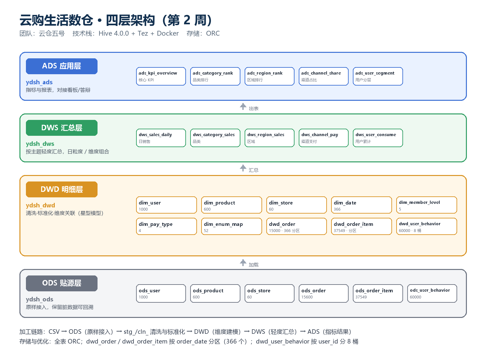

# 第 2 周 · 四层数仓架构设计文档

> 项目：云购生活新零售 —— 企业级数据仓库与经营分析可视化系统
> 团队：云仓五号
> 阶段：第 2 周 · 数据清洗进阶 · Hive 四层数仓建模 · 探索性分析
> 对应任务：任务书 子任务 5「Hive 四层数仓架构设计」
> 脚本位置：`sql/dwd/00_ddl.sql`（建表）、`sql/clean/10~13`（清洗）、`sql/dws/20_dws.sql`、`sql/ads/30_ads.sql`



---

## 一、架构总览

四层职责一句话概括：**ODS 原样接入 → DWD 洗干净并按星型模型组织 → DWS 按主题轻度汇总 → ADS 出指标给看板**。

| 分层 | 库名 | 定位 | 数据粒度 | 表名前缀 | 存储格式 | 更新方式 |
|---|---|---|---|---|---|---|
| ODS 贴源层 | `ydsh_ods` | 原样接入业务数据，保留原始脏值，可回溯 | 最细粒度，与源文件一致 | `ods_` | TEXTFILE（CSV 直读） | 全量导入 |
| DWD 明细层 | `ydsh_dwd` | 清洗、标准化、维度关联后的明细事实与维度 | 明细事实 / 维度 | `dwd_` / `dim_` | ORC | 全量重建（CTAS/INSERT OVERWRITE） |
| DWS 汇总层 | `ydsh_dws` | 按主题轻度汇总（日、品类、区域、渠道、用户） | 日 / 维度组合 | `dws_` | ORC | 全量重建 |
| ADS 应用层 | `ydsh_ads` | 面向指标与报表的结果表 | 指标级结果 | `ads_` | ORC | 全量重建 |

> ODS 层不在本周改造：第 1 周已建 6 张 `ods_*` 表并导入 114,809 行原始数据。DWD 及以上全部由脚本从 ODS 重新生成，可反复执行。

---

## 二、DWD 层表清单

### 2.1 维度表（7 张）

| 表名 | 行数 | 说明 |
|---|---:|---|
| `dim_user` | 1,000 | 用户维度：性别/年龄标准化、编码（`gender_code`、`member_level_code`）、`region` 合并、邮箱域名拆分、4 个质量标记 |
| `dim_product` | 600 | 商品维度：类目/品牌去空格（16 种写法收敛为 8 个类目）、价格异常置空可追溯、上架日期补全 |
| `dim_store` | 60 | 门店维度：`region` 合并 |
| `dim_date` | 366 | 时间维度：2024 全年（闰年），含年/季/月/周/星期/是否周末 |
| `dim_member_level` | 5 | 会员等级编码映射表（NORMAL/SILVER/GOLD/DIAMOND/UNKNOWN + 等级序号） |
| `dim_pay_type` | 4 | 支付方式编码映射表（WECHAT/ALIPAY/CARD/COD + 是否线上） |
| `dim_enum_map` | 52 | 枚举映射表：6 个字段的全部原始取值 → 规范值/编码（清洗规则可查询、可校验） |

### 2.2 事实表（3 张）

| 表名 | 行数 | 分区 | 分桶 | 说明 |
|---|---:|---|---|---|
| `dwd_order` | 15,000 | `order_date` 366 个 | 无 | 订单事实表（一单一行），17 个字段 + 金额处理标记 |
| `dwd_order_item` | 37,549 | `order_date` 366 个 | 无 | 订单明细事实表，数量/单价异常处理标记 |
| `dwd_user_behavior` | 60,000 | 无 | `user_id` 8 桶 | 用户行为日志，行为类型标准化 + 中文名 |

### 2.3 星型模型关系

```
                    dim_date (时间)
                          │
dim_user ────┐            │            ┌──── dim_product
             │            │            │
             └──────► dwd_order ◄──────┘
                          │
                          │ 1:N
                          ▼
                   dwd_order_item ──► dim_product
                          │
dim_store ────────────────┘
```

- **事实表**只放外键（`user_id`/`store_id`/`product_id`/`order_date`）与可加度量（`pay_amount`、`discount_amount`、`net_amount`、`quantity`、`item_amount`）。
- **维度表**放描述属性（`gender`、`member_level`、`category`、`province`、`region`、`weekday_name`）。
- **编码映射**：事实表存编码（`pay_type_code`、`order_status_code`、`channel_code`），维度/映射表出中文名，报表侧按需关联。
- 外键完整性：`dwd_order.user_id` 100% 命中 `dim_user`；`dwd_order_item.order_id` 100% 命中 `dwd_order`；`product_id` 100% 命中 `dim_product`（第 1 周已验证）。

---

## 三、数据流向与加工链路

```
6 个 CSV
   │  load_ods.sql
   ▼
ODS 贴源层（ydsh_ods，6 张表，114,809 行，保留原始脏值）
   │  10_enum_standardize.sql  → stg_*_enum（枚举标准化 + 映射表）
   │  11_anomaly_format.sql    → cln_*（异常值/格式处理）
   │  12_split_merge.sql       → cln_*_full（字段拆分合并 + 订单去重）
   ▼
DWD 明细层（ydsh_dwd，7 维度 + 3 事实）
   │  01_load_dim.sql / 02_load_fact.sql
   │  20_dws.sql
   ▼
DWS 汇总层（ydsh_dws，5 张主题汇总）
   │  30_ads.sql
   ▼
ADS 应用层（ydsh_ads，5 张指标表）
```

加工顺序与依赖在 `scripts/run-week2.ps1` 中固化为：`00_ddl → 10 → 11 → 12 → 01 → 02 → 13 → 20 → 30`。

---

## 四、命名规范

| 对象 | 规范 | 示例 |
|---|---|---|
| 库 | `ydsh_<层>` | `ydsh_ods`、`ydsh_dwd`、`ydsh_dws`、`ydsh_ads` |
| 贴源表 | `ods_<业务实体>` | `ods_order`、`ods_user_behavior` |
| 明细事实表 | `dwd_<业务实体>` | `dwd_order`、`dwd_order_item` |
| 维度表 | `dim_<实体>` | `dim_user`、`dim_date`、`dim_pay_type` |
| 汇总表 | `dws_<主题>_<聚合>` | `dws_sales_daily`、`dws_category_sales` |
| 应用表 | `ads_<报表主题>` | `ads_kpi_overview`、`ads_region_rank` |
| 加工中间表 | `stg_`（标准化）/ `cln_`（清洗后） | `stg_order_enum`、`cln_order_full` |
| 质量结果表 | `qc_` | `qc_metric`、`qc_config` |
| 字段 | 小写 + 下划线，布尔/标记型用 `is_`/`_flag`/`_filled` 前缀后缀 | `is_valid_amount`、`amount_flag`、`age_filled` |
| 分区字段 | 与业务时间同名 | `order_date` |
| 脚本 | 序号 + 主题，序号即执行顺序 | `10_enum_standardize.sql` |

> `stg_`/`cln_`/`qc_` 是 DWD 库内的加工中间表，保留是为了复算与答辩演示；正式环境建议迁到独立临时库，加工完即清理。

---

## 五、存储与优化设计

### 5.1 存储格式

全部 DWD/DWS/ADS 表 `stored as orc`：列式存储 + 自带压缩，适合宽表扫描与聚合；Hive 对 ORC 支持谓词下推与向量化读取。

### 5.2 分区表（分区裁剪）

`dwd_order`、`dwd_order_item` 按 `order_date` 动态分区，实测：

| 指标 | dwd_order | dwd_order_item |
|---|---:|---:|
| 分区数 | 366 | 366 |
| 文件数 | 366 | 366 |
| 表大小 | 1.33 MB | 1.27 MB |

分区裁剪证据（`explain dependency`）：

```sql
-- 带分区条件：只命 1 个分区
explain dependency select count(*) from dwd_order where order_date = '2024-06-15';
-- input_partitions: [ydsh_dwd@dwd_order@order_date=2024-06-15]

-- 用函数包住分区键：命中 6 月全部 30 个分区，无法裁剪
explain dependency select count(*) from dwd_order where substr(order_date,1,7) = '2024-06';
-- input_partitions: 2024-06-01 ... 2024-06-30
```

**结论**：分区键上不能套函数，否则退化为全表（全分区）扫描。

### 5.3 分桶表

`dwd_user_behavior` 按 `user_id` 分 8 桶（`clustered by (user_id) into 8 buckets`），实测 `numFiles = 8`、`Num Buckets = 8`、60,000 行。作用是同用户数据落同一桶，后续与同样按 `user_id` 分桶的用户维表做 **Map 端桶连接（bucket map join）**，避免全量 shuffle。

### 5.4 为什么事实表"分区不分区 + 分桶"分开做

`dwd_order` 若同时按 366 天分区再分 8 桶，会产生 2,928 个小文件（平均每文件 41 行），小文件开销远大于收益。因此：

- 订单/明细：**分区**（按天过滤是最常见查询形态，收益最大）；
- 行为日志：**分桶**（60,000 行、无日期强过滤需求，按用户连接更常见）。

---

## 六、关键设计决策与取舍

| # | 决策 | 理由 / 取舍 |
|---|---|---|
| 1 | ODS 原表不做任何修改，DWD 全部重建 | 非事务表不支持 UPDATE；保留原始值才能算"修复率"、做前后对比与回溯 |
| 2 | 枚举映射写成表（`dim_enum_map`），不只写死在 `case when` 里 | 映射可查询、可校验、可被报表引用；覆盖度校验能证明"没有漏映射的取值" |
| 3 | 用户/订单类枚举统一为**中文**标准值，行为日志保留**英文**编码 | 前者面向业务报表；行为日志是埋点原始编码，行业惯例为 `pv/cart/buy/fav`，中文写法属录入异常。另存 `behavior_name` 兼顾可读性 |
| 4 | 空值收敛为"未知"而不是丢弃或臆造 | `gender`/`member_level` 的空值统一为"未知"，同时保留 `*_filled` 标记，做到不丢行、可追溯 |
| 5 | 金额阈值用 **3×IQR 围栏**，不用部署手册建议的 P99 | 数据被注入 291 条百万级超大金额，P99 被顶到 551 万，按 P99 会误杀 1% 正常订单；IQR 围栏实测落在 11,356 元，恰好命中 312 条注入值 |
| 6 | 能推断的修正（取绝对值），不能推断的置空 + 打标 | 负金额/负数量视为符号错误；百万级金额与 0 件、99 件无法反推真实值，置空避免污染 GMV 与销量，标记列保证可回溯 |
| 7 | 品类 GMV 用"按明细金额占比分摊订单实付" | 明细 `unit_price × quantity` 与订单 `pay_amount` 不同源（模拟数据构造差异，明细合计约 4.2 亿 vs 实付 3,702 万），直接加总会失真；分摊后 8 个品类合计 3,679.46 万，覆盖 GMV 的 99.37%，差额 23.32 万来自 94 单"全部明细金额不可归类"的订单（数量为 0 或超围栏被置空），不做强行归属 |
| 8 | DWS/ADS 用 CTAS 重建 | 口径仍在迭代期，CTAS 让脚本"删了重建"即可，避免 ALTER 带来的不一致；DWD 的建表用显式 DDL，因为它是稳定契约 |

---

## 七、与第 1 周的关系

- 第 1 周在 `ydsh_ods` 库里建了 6 张 `dwd_*` 表（缺失值/重复值处理 + 异常标记），属于"第 1 周的清洗产物"。本周的 DWD 层改用独立库 `ydsh_dwd`，从 ODS 重新加工，**不覆盖第 1 周产物**，便于对照：
  - 第 1 周：`ydsh_ods.dwd_user`（age 均值填充，其余只标记）
  - 第 2 周：`ydsh_dwd.dim_user`（枚举规范化 + 编码 + region + 标记，且可被事实表关联）
- 第 1 周标记过的两类问题（枚举混用、金额/数量异常）本周全部规范化并给出修复率，清洗闭环。

---

## 八、交付校验清单

| 校验项 | 期望 | 实测 |
|---|---|---|
| 维度表行数 | user 1000 / product 600 / store 60 / date 366 | ✅ 一致 |
| 事实表行数 | order 15000（去重后）/ item 37549 / behavior 60000 | ✅ 一致 |
| 分区数 | 366 | ✅ `show partitions` 列出 366 个日期分区 |
| 分桶数 | 8 | ✅ `Num Buckets: 8`，`numFiles: 8` |
| 枚举取值收敛 | 各字段只剩规范值域 | ✅ gender 3 / member 5 / status 5 / pay 4 / channel 4 / behavior 4 |
| 编码完整性 | 性别、会员等级编码无空值 | ✅ `gender_code` 空 0、`member_level_code` 空 0 |
| 金额异常残留 | 负金额 0、超大金额 0 | ✅ 负 0 / 超大 0，有效金额订单 14,696 |
| 日期格式 | 全部 `yyyy-MM-dd` | ✅ 非规范 0 |

> 详细质量数据见 `reports/第2周_数据质量对比报告.md`，分析结论见 `reports/第2周_探索性分析简报.md`。
