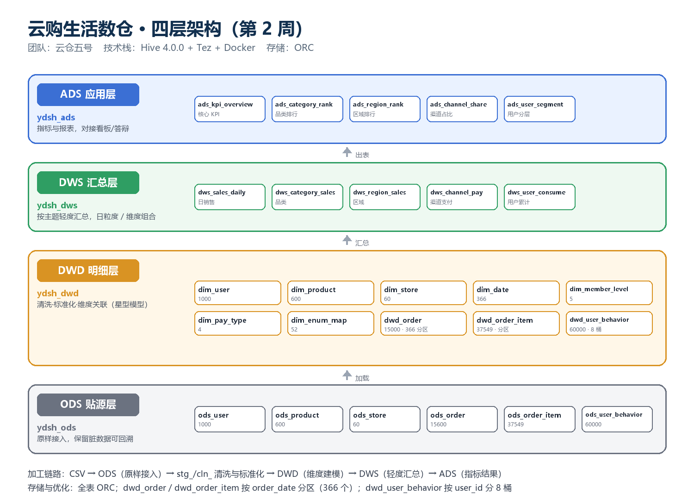

# 第 2 周 · 数据清洗进阶 · 四层数仓建模 · 探索性分析

> 对应任务书：`02_第2周任务书.docx`、`02_第2周部署操作手册.docx`
> 团队：云仓五号
> 依赖：**必须先跑过 [第1周](../第1周/)**（环境与 `ydsh_ods` 里的 6 张 ODS 表由第 1 周提供）

## 一、本周目标（7 个子任务）

| # | 子任务 | 产出 |
|---|---|---|
| 1 | 枚举字段标准化（6 个字段） | 清洗脚本 + `dim_enum_map` 映射表 |
| 2 | 异常值与格式标准化 | 金额/价格/数量/日期/手机号/行为时间 |
| 3 | 字段拆分合并与编码映射 | `order_timestamp`、`region`、编码维表 |
| 4 | 数据质量对比报告 | 五类脏数据修复率 |
| 5 | Hive 四层数仓架构设计 | 架构文档 + 架构图 |
| 6 | DWD 层维度建模与数据加载 | 7 维度 + 3 事实，分区 / 分桶 |
| 7 | 探索性数据分析 | 分析 SQL + 简报 |

## 二、目录结构

```
第2周\
├── sql\
│   ├── clean\
│   │   ├── 10_enum_standardize.sql   # 枚举标准化 + 映射表
│   │   ├── 11_anomaly_format.sql     # 异常值与格式
│   │   ├── 12_split_merge.sql        # 拆分合并 + 订单去重
│   │   └── 13_quality_compare.sql    # 质量对比（qc_metric）
│   ├── dwd\
│   │   ├── 00_ddl.sql                # 7 维度 + 3 事实建表
│   │   ├── 01_load_dim.sql
│   │   └── 02_load_fact.sql
│   ├── dws\20_dws.sql                # 6 张主题汇总（含门店）
│   ├── ads\30_ads.sql                # 6 张指标表（含门店排行）
│   └── analysis\40_eda.sql           # 探索性分析
├── reports\
│   ├── 第2周_数据质量对比报告.md
│   ├── 第2周_探索性分析简报.md
│   ├── 第2周_运行记录.md             # 终端真实输出
│   └── 第2周_运行看板.html           # 浏览器打开的可视化看板
├── docs\
│   ├── 第2周_数仓架构设计.md
│   ├── 第2周_答辩手册.md
│   ├── 第2周_AI协同日志.md
│   └── screenshots\                 # 架构图、分析图、看板截图
├── scripts\
│   ├── run-week2.ps1                # 一键：10 个脚本按依赖顺序执行
│   ├── create-desktop-shortcut.ps1  # 在桌面生成 3 个快捷方式
│   └── fix-metastore-charset.ps1    # 修复表注释变问号（元数据库 latin1）
└── 一键运行_第2周.bat                # 双击入口
```

## 三、快速开始

### 3.1 桌面一键（推荐）

| 双击 | 作用 |
|---|---|
| **第2周 一键运行** | 起环境 → 等 Hive → 跑完 10 个脚本 → 打印结果 → 自动打开看板 |
| **第2周 终端结果** | 不重跑，只重新打印终端结果表（窗口停留） |
| **第2周 查看结果** | 不重跑，直接打开看板 |

快捷方式由 [scripts/create-desktop-shortcut.ps1](scripts/create-desktop-shortcut.ps1) 生成；项目搬家后重跑一次即可。

### 3.2 命令行

```powershell
# 完整跑（约 3.5 分钟）
powershell -File scripts/run-week2.ps1

# 只看终端结果表
powershell -File scripts/run-week2.ps1 -ShowOnly

# 只打开看板
powershell -File scripts/run-week2.ps1 -SkipRun
```

脚本自动用 `docker compose -f ..\第1周\docker-compose.yml` 启动同一套环境
（项目名固定 `dshproject`），并检查 `ydsh_ods.ods_order` 是否已有数据；没有则提示先跑第 1 周。

## 四、分层架构



| 分层 | 库 | 内容 | 表数 |
|---|---|---|---|
| ODS 贴源层 | `ydsh_ods` | 6 张原始表，114,809 行 | 6（第 1 周建） |
| DWD 明细层 | `ydsh_dwd` | 7 维度 + 3 事实，ORC；订单按日分区 366 个，行为按 `user_id` 分 8 桶 | 10 |
| DWS 汇总层 | `ydsh_dws` | 日 / 品类 / 区域 / 渠道支付 / 用户累计 / 门店 | 6 |
| ADS 应用层 | `ydsh_ads` | KPI、品类排行、区域排行、渠道占比、用户分层、门店排行 | 6 |

## 五、本周成果

| 指标 | 结果 |
|---|---|
| 五类脏数据 | 15,980 处，修复 15,787 处（**98.8%**） |
| 有效订单 / GMV / AOV | 14,696 单 / **3,702.79 万元** / 2,519.59 元 |
| 品类第一 | 运动户外 14.88% |
| 维度建模 | 星型模型，事实表 366 分区、行为表 8 桶 |
| 代码规模 | 10 个 SQL 脚本 + 3 个 PowerShell 脚本，一键可重跑 |

## 五之二、提交物（对照《第 2 周作业任务与提交清单》）

| 清单要求 | 本目录文件 | 格式 |
|---|---|---|
| 数据质量对比报告 | `reports/数据质量对比报告.docx`（源：`第2周_数据质量对比报告.md`） | Word |
| 数仓架构设计文档 | `docs/数仓架构设计文档.docx`（源：`第2周_数仓架构设计.md`） | Word |
| 探索性分析简报 | `reports/探索性分析简报.docx`（源：`第2周_探索性分析简报.md`） | Word |
| AI 协同日志 | `docs/第2周_AI协同日志.md`（按模板五部分，12 条记录） | Markdown |
| 清洗 / 建模脚本 | `sql/clean/`、`sql/dwd/` | 代码（Git） |
| 打包提交 | `第2周_提交.zip` | 压缩包 |

> `.docx` 由 `scripts/md2docx.py` 从同名 Markdown 生成（保持单一数据源）：
> `python scripts/md2docx.py <input.md> <output.docx>`。

## 六、交付物清单（对照任务书）

| # | 交付物 | 位置 |
|---|---|---|
| 1 | 枚举 / 异常 / 格式清洗脚本 | `sql/clean/10~13` |
| 2 | 数据质量对比报告 | [reports/第2周_数据质量对比报告.md](reports/第2周_数据质量对比报告.md) |
| 3 | 数仓架构设计文档 | [docs/第2周_数仓架构设计.md](docs/第2周_数仓架构设计.md) |
| 4 | DWD 建模与 ETL 脚本 | `sql/dwd/` |
| 5 | 探索性分析简报 | [reports/第2周_探索性分析简报.md](reports/第2周_探索性分析简报.md) |
| 6 | Git 提交记录 | 每个子任务一次提交，`git log --oneline` 可查 |

## 七、说明

- **阈值不用 P99**：本数据注入的百万级金额把 P99 顶到 551 万，改用 `Q3+3×IQR` 围栏（实测 11,356 元）。
- **能推断的修正、不能推断的置空、全部打标**：负金额/负数量取绝对值，百万级金额与 0 件置空并标记。
- **邮箱缺失不造数**：193 条保留空值 + `email_missing` 标记，所以总修复率是 98.8% 而不是 100%。
- **品类 GMV 用分摊**：明细单价与订单实付不同源，按明细金额占比分摊实付，覆盖 GMV 的 99.37%。
- **终端表格按显示宽度对齐**：脚本自己渲染表格（中文占 2 列），避免 beeline 表格错位。
