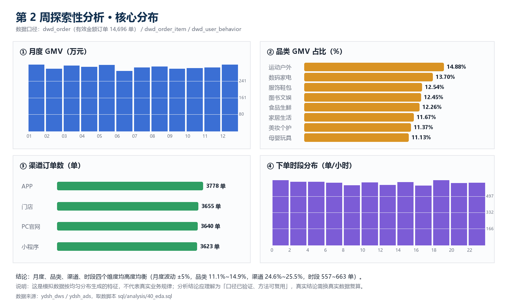

# 第 2 周 · 探索性分析简报

> 项目：云购生活新零售 —— 企业级数据仓库
> 团队：云仓五号
> 阶段：第 2 周 · 基于 DWD 明细层的探索性分析
> 对应任务：任务书 子任务 7「探索性数据分析」
> 取数脚本：`sql/analysis/40_eda.sql`（全部可在 Hive 中重复执行）

---

## 一、分析口径

| 项目 | 说明 |
|---|---|
| 数据范围 | 2024-01-01 ~ 2024-12-31，`dwd_order` 15,000 单（去重后，一单一行） |
| 金额口径 | 只统计 `is_valid_amount = 1` 的订单（14,696 单），排除 304 条超大金额置空单 |
| GMV | 有效订单 `pay_amount` 之和 |
| 客单价 AOV | GMV / 有效订单量 |
| 品类 GMV | 按明细金额占比**分摊**订单实付金额（因明细单价与订单实付不同源，见架构文档决策 7） |
| 买家 | `count(distinct user_id)` |
| 分析层级 | 明细统计直接查 `ydsh_dwd`，分布/排行读 `ydsh_dws` / `ydsh_ads`，两处结果已交叉验证一致 |

---

## 二、核心指标

| 指标 | 数值 |
|---|---:|
| 总订单量 | 15,000 单 |
| 有效订单量 | 14,696 单（97.97%） |
| GMV | 37,027,857.67 元（3,702.79 万） |
| 客单价 AOV | 2,519.59 元 |
| 下单用户数 | 1,000 人（注册用户 100% 下单） |
| 人均订单数 | 15.0 单 |
| 人均消费 | 37,027.86 元 |
| 订单覆盖日期 | 366 天（全年无空档） |

---

## 三、分布分析

### 3.1 月度趋势：全年平稳，无季节性

| 月份 | 订单（全部） | 有效订单 | GMV（元） | AOV（元） | 买家 |
|---|---:|---:|---:|---:|---:|
| 2024-01 | 1,278 | 1,246 | 3,211,882.66 | 2,577.75 | 713 |
| 2024-02 | 1,203 | 1,178 | 3,000,286.07 | 2,546.93 | 675 |
| 2024-03 | 1,288 | 1,262 | 3,163,010.22 | 2,506.35 | 711 |
| 2024-04 | 1,219 | 1,193 | 3,091,403.44 | 2,591.29 | 695 |
| 2024-05 | 1,301 | 1,281 | 3,192,180.16 | 2,491.94 | 728 |
| 2024-06 | 1,154 | 1,132 | 2,901,575.33 | 2,563.23 | 676 |
| 2024-07 | 1,244 | 1,224 | 3,060,683.87 | 2,500.56 | 716 |
| 2024-08 | 1,274 | 1,244 | 3,108,832.52 | 2,499.06 | 711 |
| 2024-09 | 1,228 | 1,196 | 3,002,012.59 | 2,510.04 | 710 |
| 2024-10 | 1,289 | 1,266 | 3,039,816.74 | 2,401.12 | 741 |
| 2024-11 | 1,231 | 1,208 | 3,059,187.99 | 2,532.44 | 726 |
| 2024-12 | 1,291 | 1,266 | 3,196,986.08 | 2,525.27 | 723 |

**观察**：月度 GMV 在 290.2 万 ~ 321.2 万之间波动（极差 ±5%），AOV 稳定在 2,401~2,591 元。没有大促峰值，也没有淡季塌陷——与模拟数据按均匀分布生成有关，不能据此推断"业务无季节性"。

### 3.2 品类结构：8 个类目均衡，运动户外第一

| 排名 | 品类 | 订单数 | 件数 | 分摊 GMV（元） | 占比 |
|---:|---|---:|---:|---:|---:|
| 1 | 运动户外 | 4,642 | 16,243 | 5,474,186.74 | 14.88% |
| 2 | 数码家电 | 4,317 | 15,003 | 5,040,378.69 | 13.70% |
| 3 | 服饰鞋包 | 4,012 | 13,529 | 4,613,402.98 | 12.54% |
| 4 | 图书文娱 | 3,995 | 13,595 | 4,581,967.56 | 12.45% |
| 5 | 食品生鲜 | 3,953 | 13,358 | 4,512,589.20 | 12.26% |
| 6 | 家居生活 | 3,646 | 12,219 | 4,294,531.64 | 11.67% |
| 7 | 美妆个护 | 3,661 | 12,407 | 4,183,902.96 | 11.37% |
| 8 | 母婴玩具 | 3,562 | 11,893 | 4,093,688.18 | 11.13% |

**观察**：第一梯队（运动户外、数码家电）合计 28.6%，末位母婴玩具 11.1%，差距不到 4 个百分点，无"单一品类依赖"风险。

> 口径说明：表中 8 个品类合计 **3,679.46 万**，覆盖 GMV（3,702.79 万）的 **99.37%**。差额 23.32 万来自 94 单"全部明细金额不可归类"的订单——其明细数量为 0 或超出 IQR 围栏被置空，无法按占比分摊到品类，不做强行归属。占比结论按覆盖口径计算。

### 3.3 区域分布：省级高度均衡，直辖市单城贡献突出

| 排名 | 省份 | GMV（元） | 买家 | 订单 | AOV（元） | 占比 |
|---:|---|---:|---:|---:|---:|---:|
| 1 | 陕西省 | 2,910,818.52 | 79 | 1,151 | 2,528.95 | 7.86% |
| 2 | 重庆市 | 2,782,810.13 | 76 | 1,093 | 2,546.03 | 7.52% |
| 3 | 辽宁省 | 2,774,884.91 | 75 | 1,103 | 2,515.76 | 7.49% |
| 4 | 河南省 | 2,639,178.19 | 73 | 1,051 | 2,511.11 | 7.13% |
| 5 | 福建省 | 2,622,999.03 | 69 | 1,022 | 2,566.54 | 7.08% |
| 6 | 安徽省 | 2,587,144.31 | 68 | 1,055 | 2,452.27 | 6.99% |
| 7 | 上海市 | 2,552,098.15 | 70 | 999 | 2,554.65 | 6.89% |
| 8 | 北京市 | 2,549,255.42 | 70 | 1,039 | 2,453.57 | 6.88% |

城市维度 TOP5：重庆（278.3 万）、上海（255.2 万）、北京（254.9 万）、杭州（79.1 万）、渭南（71.4 万）。直辖市"省=市"，单城市即贡献 2.5% 以上 GMV；其余省份为多城市分摊（如陕西省由 7 个城市构成）。

### 3.4 渠道：四渠道几乎均分

| 渠道 | 订单数 | GMV（元） | 占比 |
|---|---:|---:|---:|
| APP | 3,778 | 9,430,444.23 | 25.47% |
| 门店 | 3,655 | 9,255,248.18 | 25.00% |
| PC官网 | 3,640 | 9,225,809.15 | 24.92% |
| 小程序 | 3,623 | 9,116,356.11 | 24.62% |

渠道 × 支付方式交叉后，16 个组合的 GMV 均落在 205 万 ~ 254 万，说明渠道与支付方式相互独立，没有"某渠道只支持某支付"的耦合。

### 3.5 门店分布：60 家店销售高度均匀，坪效与面积负相关

| 排名 | 门店 | 省份 / 城市 | 面积(㎡) | 订单 | GMV（元） | AOV（元） | 坪效（元/㎡） |
|---:|---|---|---:|---:|---:|---:|---:|
| 1 | 云购生活·绍兴旗舰店 | 浙江 / 绍兴 | 488 | 263 | 722,457.44 | 2,746.99 | 1,480.45 |
| 2 | 云购生活·北京二店 | 北京 / 北京 | 128 | 289 | 713,114.38 | 2,467.52 | 5,571.21 |
| 3 | 云购生活·合肥购物中心店 | 安徽 / 合肥 | 575 | 267 | 707,147.03 | 2,648.49 | 1,229.82 |
| 4 | 云购生活·莆田旗舰店 | 福建 / 莆田 | 147 | 269 | 704,669.09 | 2,619.59 | 4,793.67 |
| 5 | 云购生活·开封社区店 | 河南 / 开封 | 618 | 268 | 695,991.28 | 2,596.98 | 1,126.20 |
| 6 | 云购生活·株洲一店 | 湖南 / 株洲 | 269 | 265 | 693,051.23 | 2,615.29 | 2,576.40 |
| 7 | 云购生活·嘉兴社区店 | 浙江 / 嘉兴 | 686 | 255 | 687,586.96 | 2,696.42 | 1,002.31 |
| 8 | 云购生活·大连二店 | 辽宁 / 大连 | 522 | 262 | 686,426.41 | 2,619.95 | 1,314.99 |
| 9 | 云购生活·德阳购物中心店 | 四川 / 德阳 | 550 | 271 | 676,303.79 | 2,495.59 | 1,229.64 |
| 10 | 云购生活·泸州社区店 | 四川 / 泸州 | 184 | 262 | 673,700.55 | 2,571.38 | 3,661.42 |

- 60 家门店 GMV 区间 **52.45 万 ~ 72.25 万**，均值 61.71 万，极差仅 ±17%，说明订单在门店间近似均摊；
- 门店数按省份：浙江 7 家（433.32 万，11.7%）、湖南 6 家、四川 6 家、辽宁 5 家、陕西 5 家，广东仅 1 家（58.43 万）；
- 坪效 TOP5 全是 **121~147 ㎡ 的小店**（北京二店 5,571 元/㎡、武汉购物中心店 5,176、苏州旗舰店 4,901、苏州购物中心店 4,873、莆田旗舰店 4,794），
  而 600 ㎡ 以上的社区店坪效只有 1,000~1,300 元/㎡。

> **注意**：坪效与面积负相关是"销售额近似均分 + 面积差异大"的必然结果，
> 不能解读为"小店经营效率更高"。真实业务判断坪效需同时看客流、客单价与品类结构。

### 3.6 时段：全天均摊，无晚高峰

| 时段 | 订单 | 说明 |
|---|---:|---|
| 0 点 | 663 | 全天最高 |
| 9 点 | 557 | 全天最低 |
| 其余 | 602~661 | 波动在 ±8% 内 |

**注意**：真实零售业务通常呈"午间 + 晚间"双峰，本数据 24 小时近似均匀，属模拟数据特征。该结论不可用于排班/推送时段决策，只证明"时段分析口径已跑通"。

---

## 四、用户分析

### 4.1 会员等级的贡献：等级决定频次，不决定客单价

| 会员等级 | 用户数 | 订单数 | GMV（元） | 占比 | AOV（元） |
|---|---:|---:|---:|---:|---:|
| 金卡会员 | 273 | 3,989 | 10,081,864.91 | 27.23% | 2,527.42 |
| 钻石会员 | 253 | 3,727 | 9,357,106.34 | 25.27% | 2,510.63 |
| 普通会员 | 230 | 3,401 | 8,624,692.72 | 23.29% | 2,535.93 |
| 银卡会员 | 230 | 3,363 | 8,424,488.69 | 22.75% | 2,505.05 |
| 未知 | 14 | 216 | 539,705.01 | 1.46% | 2,498.63 |

**发现**：五个等级的 AOV 全部落在 2,498~2,536 元（差异 <1.5%），但订单量随等级上升（金卡比银卡多 18.6%）。说明在本数据中，等级提升带来的是**下单频次**而非单笔金额——会员权益设计应瞄准频次（如免邮、专属日），而非大额满减。

### 4.2 性别与年龄

| 性别 | 用户数 | 订单 | GMV（元） | 占比 | AOV（元） |
|---|---:|---:|---:|---:|---:|
| 女 | 429 | 6,301 | 15,841,580.39 | 42.78% | 2,514.16 |
| 男 | 379 | 5,607 | 14,182,020.41 | 38.30% | 2,529.34 |
| 未知 | 192 | 2,788 | 7,004,256.87 | 18.92% | 2,512.28 |

| 年龄段 | 订单 | GMV（元） | 占比 | AOV（元） |
|---|---:|---:|---:|---:|
| 35-44 | 3,927 | 9,922,555.32 | 26.80% | 2,526.75 |
| 55+ | 3,015 | 7,540,844.67 | 20.37% | 2,501.11 |
| 25-34 | 2,886 | 7,319,623.24 | 19.77% | 2,536.25 |
| 45-54 | 2,757 | 6,973,444.41 | 18.83% | 2,529.36 |
| 18-24 | 2,111 | 5,271,390.03 | 14.24% | 2,497.11 |

女性用户数、订单量、GMV 均高于男性；35-44 岁是最大客群（26.8%）。**注意**：192 名"未知"性别用户占人数 19.2%、GMV 18.9%、AOV 2,512 元，与整体（2,519.59 元）几乎一致——说明性别缺失接近随机（MCAR），用"未知"保留不会让统计系统性偏移，但会让性别分析少掉近 1/5 样本，结论需标注覆盖度。

### 4.3 用户价值分层（按累计消费四分位）

| 分层 | 用户数 | GMV（元） | 占比 | 人均消费（元） |
|---|---:|---:|---:|---:|
| 高价值 | 250 | 12,991,531.70 | 35.09% | 51,966.13 |
| 潜力 | 250 | 10,014,694.72 | 27.05% | 40,058.78 |
| 一般 | 250 | 8,259,640.79 | 22.31% | 33,038.56 |
| 低价值 | 250 | 5,761,990.46 | 15.56% | 23,047.96 |

TOP10 用户（窗口函数 `row_number() over (order by total_gmv desc)`）：

| 排名 | 用户 | 订单数 | 累计消费（元） | AOV（元） |
|---:|---|---:|---:|---:|
| 1 | U000987 | 27 | 78,274.41 | 2,899.05 |
| 2 | U000050 | 22 | 71,145.33 | 3,233.88 |
| 3 | U000182 | 26 | 70,925.14 | 2,727.89 |
| 4 | U000671 | 22 | 69,921.39 | 3,178.25 |
| 5 | U000972 | 23 | 69,053.61 | 3,002.33 |

### 4.4 复购分布：本数据几乎全是"高频客"

| 有效订单数 | 用户数 | GMV（元） | 占比 |
|---|---:|---:|---:|
| 7 单以上 | 991 | 36,909,542.59 | 99.68% |
| 4-6 单 | 9 | 118,315.08 | 0.32% |
| 1-3 单 | 0 | 0 | 0% |

**这是数据特征而非业务结论**：1,000 个用户被均匀分配了 15,000 单（人均 15 单），因此不存在新客、低频客群。真实业务中 1 单用户通常占 60% 以上，本周的复购口径（`having count(*)>=2`）与实现已验证可用，但数值不能用于经营判断。

### 4.5 行为漏斗

| 行为 | 事件数 | 用户数 | 会话数 |
|---|---:|---:|---:|
| 浏览 pv | 34,160 | 1,000 | 33,546 |
| 购买 buy | 11,969 | 1,000 | 11,904 |
| 加购 cart | 8,286 | 1,000 | 8,251 |
| 收藏 fav | 5,585 | 995 | 5,568 |

- 加购率（cart / pv）= **24.3%**
- 购买率（buy / pv）= **35.0%**
- 收藏率（fav / pv）= **16.3%**

**注意**：`buy` 事件数高于 `cart`，说明行为日志不是"pv → cart → buy"的会话级链路（用户可直接购买），因此不能当严格漏斗算转化率，只能作为**行为量级占比**看。若要做真漏斗，需要 `session_id` 内的时序关系，本周未展开。

---

## 五、关键发现（汇总）

1. **规模与结构**：15,000 单、3,702.79 万 GMV、AOV 2,519.59 元；品类、省份、渠道、门店四个维度都高度均衡（品类 11.1%~14.9%，省份 6.9%~7.9%，渠道 24.6%~25.5%，门店 GMV 52.5 万~72.2 万），没有明显的"头部集中"。
2. **会员体系的问题**：等级越高订单越多，但 AOV 几乎不变（2,498~2,536 元）。现有等级权益若按"客单价"设计是无效的，应按**频次**设计。
3. **性别缺失接近随机**：192 名"未知"性别用户占人数 19.2%、GMV 18.9%，AOV 与整体持平，说明缺失不改变消费结构；但性别维度分析的有效样本只剩 80.8%，结论需标注覆盖度。
4. **品类金额口径必须澄清**：明细单价合计 4.2 亿与订单实付 3,702 万相差 11 倍，直接用明细金额做品类销售额会虚高。本周用"占比分摊"解决，属于数据治理层面的必要处理。
5. **时段/月度扁平**是模拟数据的均匀分布特征，不能作为业务结论；但口径与 SQL 已验证，换真实数据可直接复算。
6. **复购口径可用、数值不可用**：991/1,000 用户为 7 单以上，与真实零售差异极大，需真实数据重算。
7. **门店坪效是"面积倒数"**：60 家店销售额近似均摊（52.5 万~72.2 万），坪效 = GMV/面积 因此与小面积强相关（128 ㎡ 的北京二店 5,571 元/㎡，686 ㎡ 的嘉兴社区店 1,002 元/㎡）。这个指标在本数据里不能用于评价店效，需结合客流、客单价与品类结构。

---

## 六、建议

| 方向 | 建议 | 依据 |
|---|---|---|
| 品类运营 | 运动户外、数码家电作为主推第一梯队；母婴玩具件数最少，可用组合券拉新 | 3.2 节 |
| 区域投放 | 省级均衡，适合全国统一投放；直辖市做城市级活动（单城贡献 >2.5%） | 3.3 节 |
| 渠道 | 四渠道无短板，重点做跨渠道会员权益打通，而非补短板 | 3.4 节 |
| 门店 | 60 家店销售近似均摊，坪效差异主要由面积驱动；选址/考核应补客流与转化指标，不宜只看坪效 | 3.5 节 |
| 会员权益 | 按"下单频次/连续下单"设计权益，避免大额满减 | 4.1 节 |
| 高价值用户 | 250 名高价值用户贡献 35% GMV，建 1v1 维护名单；低价值 250 人用满减提频次 | 4.3 节 |
| 数据治理 | 补全 `email`（193 条）支持触达；`gender` 缺失 84 条虽近似随机，但会让性别分析样本降到 80.8%，建议接入注册补全 | 质量报告第六节、4.2 节 |

---

## 七、局限说明

1. 数据为课程模拟数据（均匀分布 + 人工注入脏值），分布类结论仅证明**方法与口径可用**，不能替代真实业务判断。
2. 行为日志缺少会话级时序，未做严格转化漏斗。
3. 复购、留存类指标需跨周期数据，本周仅有单年快照。
4. 品类 GMV 为分摊值，覆盖 GMV 的 99.37%（94 单明细全不可用未归入品类）；单一品类的绝对金额精度受明细金额占比影响，占比结论比绝对值更可靠。
