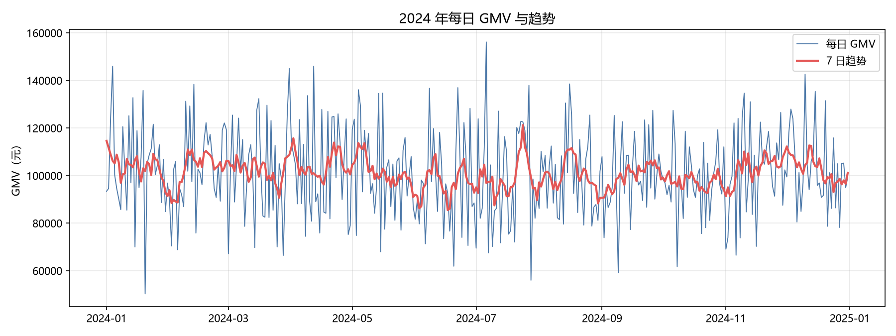
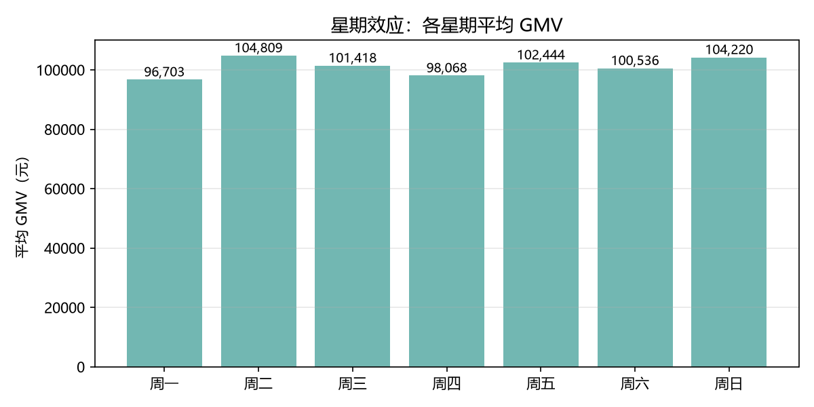
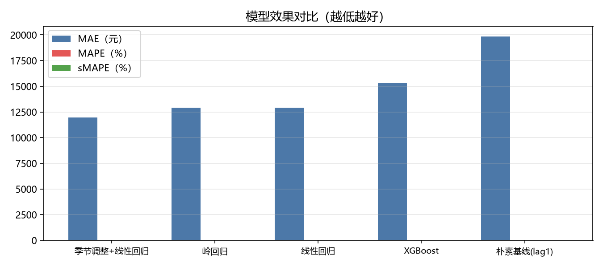
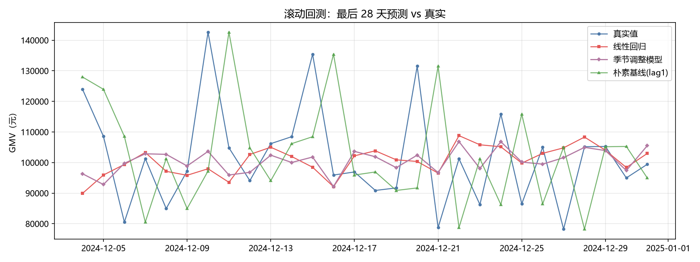
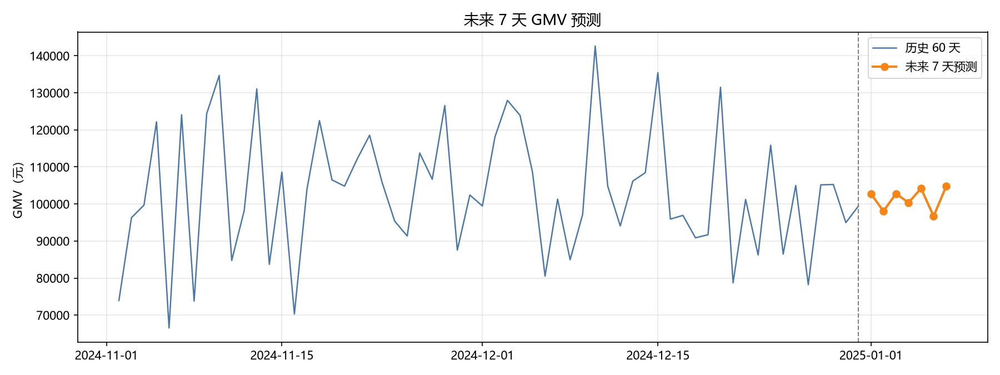

# 第 3 周 预测建模分析报告

> 团队：云仓五号　日期：2026-11-09
> 数据：`ydsh_ads.ads_sales_daily_report`，2024-01-01 ～ 2024-12-31，共 366 天
> 代码：`第3周/py/forecast.py`　口径：`docs/第3周_指标定义文档.md`

## 一、数据概况

| 指标 | 数值 |
|---|---|
| 样本天数 | 366 天（闰年，无缺失日） |
| GMV 合计 | 37,027,857.67 元 |
| 日均 GMV | 101,169.01 元 |
| 标准差 | 18,672.30 元 |
| 最小值 | 50,273.30 元 |
| 最大值 | 156,210.93 元 |

## 二、趋势分解

采用加法分解：`GMV = 趋势 + 星期效应 + 残差`。
趋势用居中 7 日移动平均（去掉星期效应），星期效应用去趋势后的各星期均值。

| 星期 | 效应（元） |
|---|---|
| 周一 | -4,549.94 |
| 周二 | 3,582.95 |
| 周三 | 217.31 |
| 周四 | -3,123.12 |
| 周五 | 1,249.35 |
| 周六 | -672.36 |
| 周日 | 3,084.40 |

**结论**：
- 星期效应最强的是 **周二**（3,582.95 元），
  最弱的是 **周一**（-4,549.94 元），
  两者相差 8,132.89 元。
- 残差标准差 17,448.81 元，占日均 GMV 的 17.25%。
  **这个比例说明：即使完全掌握趋势和星期规律，仍有约 17% 的日波动无法解释**——
  这是模型精度的天然天花板，也是后面 MAPE 停留在 10% 量级的根本原因。

## 三、模型与回测方法

### 3.1 为什么必须用滚动回测

时间序列**不能用随机 KFold**：随机切分会把「未来的数据」混进训练集，
模型在测试集上表现虚高，上线后立刻失效。

本报告采用**滚动回测（walk-forward）**：
用最后 28 天做测试，第 t 天只用 `[0, t)` 的数据训练，逐日推进，
完全模拟「每天早上看昨天为止的数据，预测今天」的真实场景。

### 3.2 特征工程

只用当天及以前的信息，避免未来信息泄露：

| 特征 | 含义 |
|---|---|
| lag1 ～ lag7 | 前 1～7 天 GMV |
| ma7 / ma14 | 前 7 / 14 天移动平均（先 shift(1) 再 rolling，不含当天） |
| weekday | 星期几（0=周一） |
| is_weekend | 是否周末 |
| month | 月份（年内季节性） |
| day_of_month | 月内日序（月初/发薪日效应） |

### 3.3 对比的四个模型

1. **朴素基线（lag1）**：直接用昨天 GMV 当今天预测。这是**必须建立的参照系**——
   任何模型打不过它，就没有上线的理由。
2. **线性回归**：13 个特征直接线性拟合。
3. **岭回归**：L2 正则，缓解滞后特征之间的多重共线性。
4. **XGBoost**：梯度提升树，捕捉非线性。
5. **季节调整 + 线性回归**：先去星期效应 → 在去季节化序列上回归 → 预测后乘回星期因子。
   这一路是为解决「递归预测向均值收敛」问题而专门设计的（见第五节）。

## 四、回测结果

| 模型 | MAE（元） | RMSE（元） | MAPE | sMAPE |
|---|---|---|---|---|
| 季节调整+线性回归 | 11,940.79 | 15,789.91 | 11.54% | 11.59% |
| 岭回归 | 12,899.27 | 17,411.40 | 12.42% | 12.53% |
| 线性回归 | 12,914.72 | 17,420.27 | 12.43% | 12.54% |
| XGBoost | 15,355.87 | 18,527.47 | 15.39% | 14.91% |
| 朴素基线(lag1) | 19,849.59 | 24,445.98 | 19.88% | 19.15% |

**结论**：
- 最优模型为 **季节调整+线性回归**，MAPE = 11.54%，
  相比朴素基线（MAPE 19.88%）**降低 42.0%**。
- 线性回归与岭回归几乎无差异（MAPE 12.43% vs 12.42%），说明**特征本身近似共线但正则收益很小**，
  模型复杂度不是瓶颈。
- **XGBoost 反而更差**（MAPE 15.39%）：
  样本只有 352 天，树模型容易记住噪声。**这直接反驳了「越复杂的模型越好」的直觉**。
- 所有模型都显著优于朴素基线，说明滞后 + 移动平均特征确实提供了增量信息。

## 五、模型适用边界（批判性审视）

### 5.1 递归预测的均值收敛问题（本周最重要的发现）

首版用**纯递归线性回归**预测未来 7 天，结果几乎是一条平线：
预测极差仅 **3,091.35 元**，变异系数（CV）
**0.95%**，而历史序列的 CV 是 **18.46%**，
两者相差一个量级。而历史数据中星期效应造成的周内极差超过 8,000 元——
**模型把这个结构性规律完全抹掉了**。

原因：递归预测时，`lag1` 等特征被**预测值**逐步填充，而不是真实观测值。
当所有滞后项都变成平滑的预测值，模型输入的方差迅速衰减，输出自然收敛到均值附近。

**诊断方法**：比较预测序列与历史序列的变异系数（CV）。

| 指标 | 纯递归线性回归 | 季节调整模型 |
|---|---|---|
| 历史 CV | 18.46% | 18.46% |
| 预测 CV | 0.95% | 3.05% |
| 比值 | 5.12% | 16.52% |
| 预测极差（元） | 3,091.35 | 8,069.02 |

**处置**：改用「季节调整 + 线性回归」路线——先把序列按星期因子去季节化，
在平稳化后的序列上回归预测，最后乘回星期因子。这样预测能保住周内结构。
改进后预测极差从 3,091.35 元提升到 8,069.02 元，
CV 从 0.95% 提升到 3.05%，
回测 MAPE 也从纯递归线性回归的 12.43% 降到
11.54%——
**结构保真与精度提升是同时发生的，不是取舍关系**。

### 5.2 其它边界

| 边界 | 说明 |
|---|---|
| **只有一年数据** | 无法做年同比，也无法验证季节规律在跨年是否稳定。2025 年的预测本质上是「2024 规律的延续假设」 |
| **无外生变量** | 促销、竞品、天气、节假日都没有数据，模型只能解释历史惯性，不能预测「黑天鹅」 |
| **MAPE 会被低值日放大** | 所以同时报 MAE / RMSE / sMAPE；三个指标排序一致，结论稳健 |
| **残差不可解释部分 17%** | 这是数据本身的随机性，不是模型缺陷，靠调参解决不了 |
| **7 天已是递归上限** | 每多预测一天误差就多累积一次，建议实际使用不超过 7 天，且每天滚动重训 |

### 5.3 业务使用建议

- 预测值应作为**预算基线**，而不是精确承诺；建议给出 ±MAPE 区间（约 ±11.54%）。
- 每天用真实数据重训，不要用一周前的模型预测今天。
- 出现 |z| ≥ 2 的异常日时，人工介入核查，不要相信模型外推。

## 六、未来 7 天 GMV 预测

| 日期 | 星期 | 预测 GMV（元） |
|---|---|---|
| 2025-01-01 | 周三 | 102,742.70 |
| 2025-01-02 | 周四 | 98,069.16 |
| 2025-01-03 | 周五 | 102,793.28 |
| 2025-01-04 | 周六 | 100,350.49 |
| 2025-01-05 | 周日 | 104,209.82 |
| 2025-01-06 | 周一 | 96,687.46 |
| 2025-01-07 | 周二 | 104,756.48 |

- **7 天合计**：709,609.39 元，日均 101,372.77 元
- 预测起点：2024-12-31，预测区间：2025-01-01 ～ 2025-01-07

**解读**：预测值在 96,687.46 ～ 104,756.48 元之间波动，
保留了「周一偏低、周二偏高」的周内规律，与历史星期效应一致。
日均 101,372.77 元略低于 2024 年日均 101,169.01 元，
差异在 MAPE 误差范围内，不构成趋势性下滑的证据。

## 七、结论

1. **最优模型**：季节调整+线性回归，MAPE 11.54%，比朴素基线降低 42.0%。
2. **模型复杂度不是关键**：XGBoost 反而最差，说明小样本下简单模型更稳。
3. **最大风险是递归收敛**：必须做变异系数诊断，否则会得到一个「看起来很准、实际毫无信息量」的平线预测。
4. **精度天花板由数据决定**：17% 的不可解释波动无法通过建模消除。
5. **适用边界**：单年数据、无外生变量、7 天以内、需每日重训。

---

*本报告由 `第3周/py/report_build.py` 自动生成，所有数字来自 Hive 实际查询与模型实际输出。*
